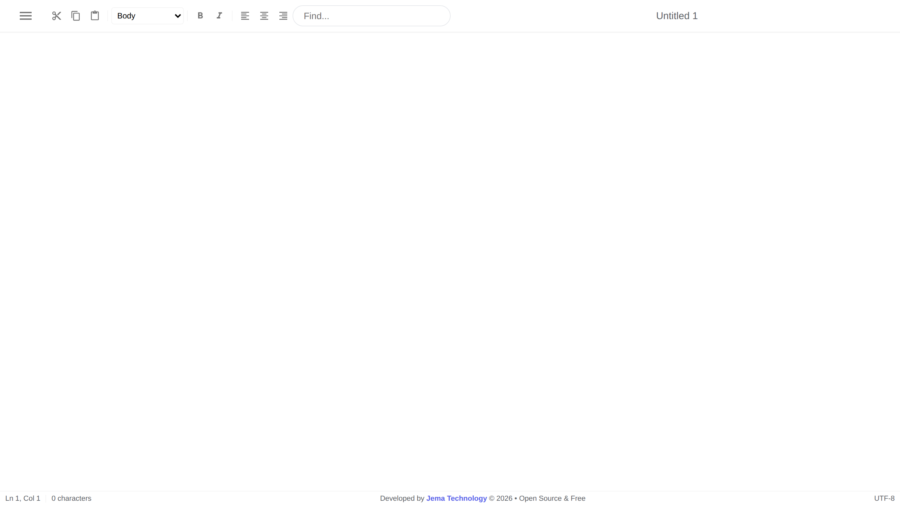
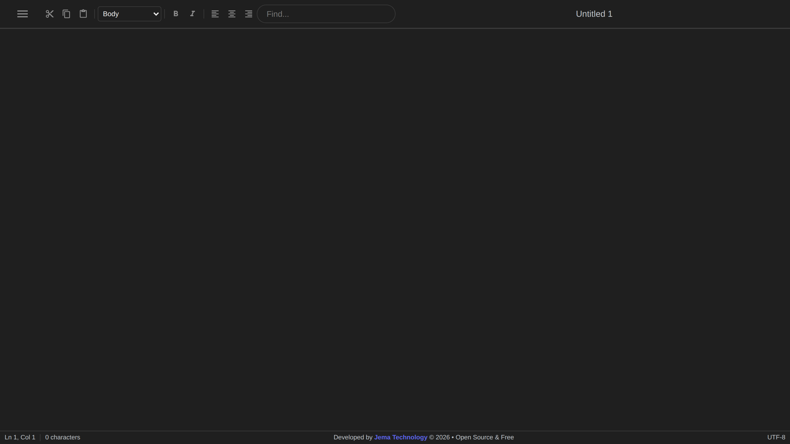
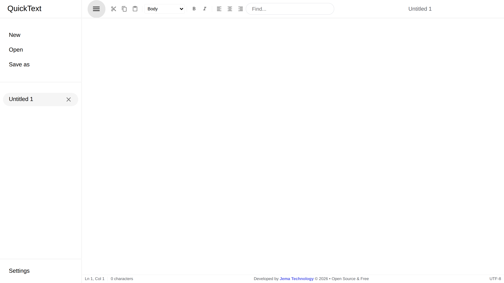
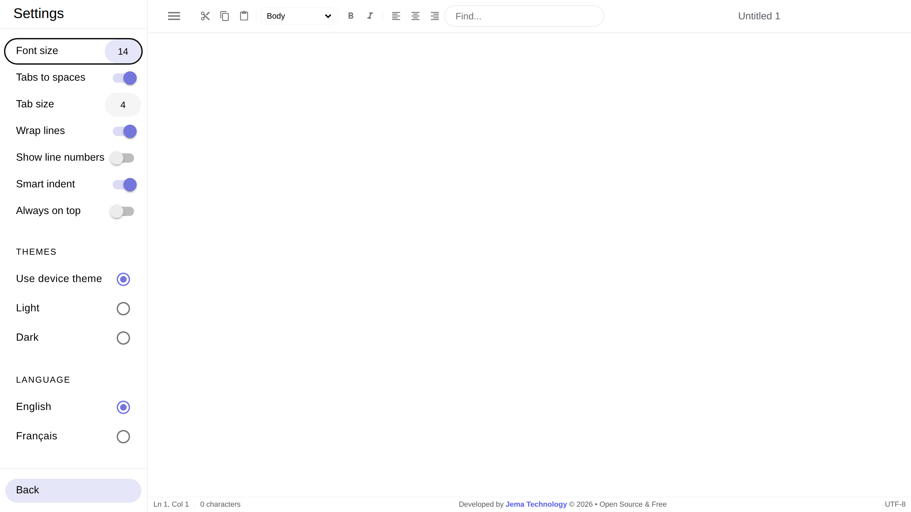
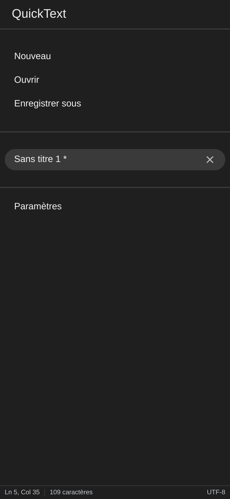
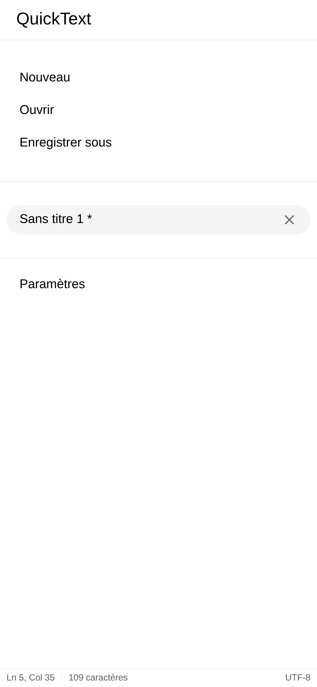

<div align="center">

<h1>QuickText</h1>

### A fast, minimalist text editor — offline-first and installable

[](https://www.jematechnology.fr)
[](LICENSE.md)
[](#-install-as-a-pwa)
[](#-tech-stack)
[](#-contributing)

**Instant load · syntax highlighting · multi-tab · keyboard-first · works offline**

[Features](#-features) · [Screenshots](#-screenshots) · [Getting started](#-getting-started) · [Tech stack](#-tech-stack) · [License](#-license)

<br>

<sub>**Keywords:** text editor · notepad · minimalist editor · lightweight editor · offline text editor · syntax highlighting · code editor · multi-tab · find and replace · markdown editor · plain text · QuickText · browser editor · installable PWA · Chrome app · vanilla JavaScript</sub>

</div>



---

## ✨ Features

- ⚡ **Fast & simple** — a lightweight editor with instant load times
- 📑 **Multi-tab editing** with session restore
- 🔤 **Syntax highlighting** for many languages (CodeMirror)
- 🔎 **Find & replace** across the current document
- 🎨 **Themes** — light and dark, follows your system
- 🌍 **English / French** UI
- 📂 **File associations** — open `.txt` and other files directly
- 📶 **PWA / offline** — install it and edit without a connection

## 📄 Supported file types

| Category | Extensions |
| --- | --- |
| Text | `.txt` `.text` `.log` `.md` `.rtf` |
| Web | `.html` `.htm` `.css` |
| Code | `.js` `.json` `.py` `.c` `.cpp` `.java` `.rs` `.go` |

---

## 📸 Screenshots

| Light | Dark |
| :---: | :---: |
|  |  |

| File menu | Settings |
| :---: | :---: |
|  |  |

### 📱 Mobile

| Dark | Light |
| :---: | :---: |
|  |  |

---

## 🚀 Getting started

### Prerequisites
- [Node.js](https://nodejs.org) 18+ (only to run the local static server)

```bash
git clone https://github.com/JemaOS/quicktext.git
cd quicktext
npm install
npm run dev        # serves the app on http://localhost:3000
```

No build step is required — QuickText is a static PWA.

### Install as a PWA

Open the app in Chrome, Edge, Brave or Safari and click **Install**. It then works fully offline.

---

## 🛠️ Tech stack

- **Vanilla HTML / CSS / JavaScript** (no framework, no bundler)
- **CodeMirror** for editing & syntax highlighting
- **Service Worker** + Web App Manifest for offline/PWA
- `chrome.*` shim to run the same code as a PWA and a Chrome App

---

## 📁 Project structure

```
js/        # editor, tabs, settings, search, i18n shim
css/       # app + print styles
_locales/  # ~20 UI languages
icon/      # app icons
sw.js      # service worker
```

---

## 🤝 Contributing

Contributions are welcome! Fork, branch, and open a pull request.

```bash
git checkout -b feat/my-feature
git commit -m "feat: my feature"
git push origin feat/my-feature
```

---

## 📄 License

Released under the **MIT License** — see [LICENSE.md](LICENSE.md).

<div align="center">
Made with ❤️ by <a href="https://www.jematechnology.fr">Jema Technology</a>
</div>
